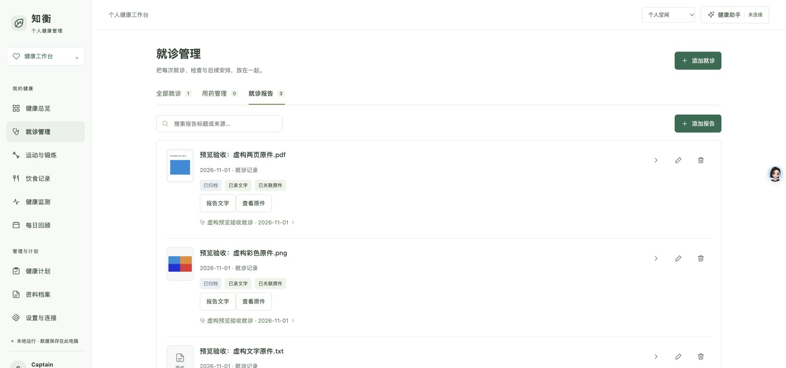
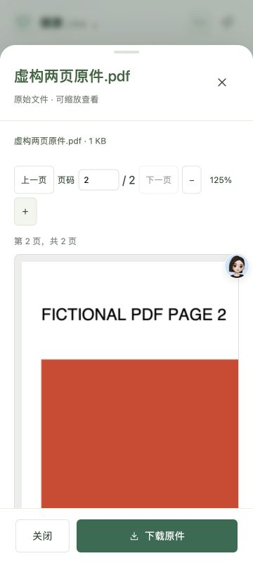

# 报告与原件预览独立验收

日期：2026-11-01（Asia/Shanghai）。目标分支：`feat/file-previews`，基线 `70b4fcb`。独立验收结论：所测用户流程通过，无已发现阻断问题；以下未覆盖项不能视作已验证。

## 环境与数据

真实 Google Chrome，通过 `mcp__cua_repl` 的 UI/DOM 观察及操作完成验收；没有使用 Playwright 工具、独立浏览器驱动脚本或真实站点。浏览器 API 内支持的只读 DOM 观察用于检查尺寸与节点。应用运行于 `http://127.0.0.1:3317`，Node v24.20.0，临时 `HEALTH_DATA_DIR=/tmp/workbench-preview-qa-4fJqX8`，`AUTH_REQUIRED=0`，仅监听本机。

通过本地 API 建立虚构就诊、3 个报告和 17 个原件。PDF 为有效两页文档：第一页蓝色矩形及 `FICTIONAL PDF PAGE 1`，第二页红色矩形及 `FICTIONAL PDF PAGE 2`；PNG 为 480×320 彩色图；TXT 和报告文字含字面量 `<script>not executable</script>`。其余 14 个 PDF 用于屏外加载检查。未读取真实资料、账号或令牌。

最后 UI 变更构建后已刷新页面，重复完成 PDF 翻页、关闭和空间切换。验收完成已关闭测试 tab，重置 360px viewport override 并终止临时服务。临时数据与截图保留以便复查。

## 实际浏览器结果

| 项目 | 可观察证据 | 结果 |
| --- | --- | --- |
| 报告内容入口 | 报告标题/报告文字打开原文抽屉；同一行有查看原件入口 | 通过 |
| 报告真实缩略图 | PDF canvas 192×240，PNG canvas 200×133；截图可见蓝色 PDF 和彩色 PNG 内容 | 通过 |
| PDF 真实渲染 | 第一页蓝色、第二页红色，文字与 fixture 相符 | 通过 |
| PDF 翻页 | 下一页变为页码 2、`第 2 页，共 2 页`，下一页禁用、上一页可用 | 通过 |
| PDF 缩放 | 125% 时 canvas 970×1213，CSS 485×607px；第二页实际内容可见 | 通过 |
| 返回报告文字 | 原件抽屉返回原报告，原始文字保留，原件 viewer 节点为 0 | 通过 |
| 文字转义 | 报告和 TXT 均显示 `<script>` 字面量，抽屉 script 节点数为 0 | 通过 |
| 图片缩放 | 480×320 原图显示；放大为 125%，适合窗口恢复 100% | 通过 |
| 档案入口 | 原件标题及缩略图可打开预览；PDF/PNG 缩略图含真实画面 | 通过 |
| 可见性懒加载 | 初始 y=397/524/778 的缩略图已渲染，y=904 至 2426 的 PDF 没有 canvas；滚动后进入视口的第06至09份出现 canvas，跳过的屏外项保持未渲染 | 通过 |
| 关闭/切换 | 关闭原件后 viewer 节点为 0；切 demo 后无个人 fixture 标题、档案为0条 | 通过 |
| 360×800移动视口 | 档案及 PDF 抽屉 html clientWidth=scrollWidth=360，无页面横向溢出；125% PDF 局部 stage clientWidth318 / scrollWidth390，可在预览内部滚动 | 通过 |
| 最终 bundle 冒烟 | 最后构建刷新后再开 PDF、翻至第二页、关闭并切 demo | 通过 |

控制台仅见其他浏览器扩展的 `chrome-extension://` 登录检查错误；未见本应用预览错误。

## 独立 HTTP 自动验收

```sh
/opt/homebrew/opt/node@24/bin/node --test tests/file-preview-http.test.mjs
```

结果：3/3 通过，0 失败，0 跳过。使用另一个临时目录和真实 Node 服务，测试后自动清理。

1. 本地版本固定 PDF.js 主模块与 worker 返回 JavaScript MIME、nosniff、immutable 缓存，响应与磁盘字节完全一致；页面 CSP 允许同源 worker 与 WASM，并未开放通用 unsafe-eval 或外部 origin。
2. WASM/CMap/字体资源 MIME 正确，响应字节与磁盘相同，WASM 魔数正确。
3. 虚构原件 inline/download 保持原字节、`no-store`、sandbox；demo 不能下载 personal 原件。

## 截图证据

两张核心证据已随仓库保存（均为虚构数据）：





以下绝对路径另保留完整本地 JPEG：

- `/tmp/workbench-preview-qa-4fJqX8/screenshots/report-thumbnails.jpg`
- `/tmp/workbench-preview-qa-4fJqX8/screenshots/pdf-page-2-zoom.jpg`
- `/tmp/workbench-preview-qa-4fJqX8/screenshots/image-zoom.jpg`
- `/tmp/workbench-preview-qa-4fJqX8/screenshots/archive-lazy.jpg`
- `/tmp/workbench-preview-qa-4fJqX8/screenshots/mobile-pdf-page2.jpg`
- `/tmp/workbench-preview-qa-4fJqX8/screenshots/mobile-archive-final.jpg`

## 明确未覆盖

- CUA 只读 DOM 不能调用 canvas `getContext`，因此没有声称取得 canvas 非空像素统计；实际彩色页面由截图和人工视觉核对确认。
- 浏览器 UI 未暴露预览任务的内部计数/网络请求时间线。可见性懒加载已动态验收；“同时不超过2个任务”仅经源代码 `running<2` 检查，未完成独立动态峰值计数。
- 关闭/切换后的可见 DOM 清理已验证；没有测量 JS heap、PDF worker 生命周期或 Object URL 的底层释放情况。
- 本次浏览器任务采用获准的本机无认证隔离模式，未覆盖真实认证撤销、跨账号切换、BFCache 恢复重新鉴权。最后 BFCache 修复后只执行刷新及常规预览冒烟，不将其当作 BFCache 专项验收。
- 未覆盖加密/损坏/超大 PDF、CJK 字形复杂排版、全部字体/编码/图片格式及真实 iOS Safari。

## 最终文件 SHA-256

- `server.mjs`: `1d57a3249dadd87a1634fce846a915935113e034c560fc82002bbe133562def6`
- `public/file-preview.js`: `b5430bb00a94e31030c693dfe9e42214786c2a196efa03e578c1af970687fd42`
- `public/app.js`: `064b106951bb7a8e4df62e475f4d93cd689e087486d84413da33d8b49ab0198e`
- `public/medical.js`: `e2f8276033879ad88814a34b0da3a1e9a59b933c30793c763ea74f06f1e8ea94`
- `public/style.css`: `9f2b0f5be278feb423ca7dca41f5d76dcea183f69e3a1e616a57c6d0dd8fe517`
- `public/index.html`: `2a725f9ad53f836de22f1cfde07d414d2967e0d45a373a839e3bb97dbffd2cc8`
- `tests/file-preview-http.test.mjs`: `47605fc5e9c19097b71052adf68f76e4a329dc3fe9d1ffe42c0ede81862491ba`

## 最后增量复核（bundle 22e30050）

最终再次启动相同隔离 fixture 并打开新 Chrome tab。在资料档案中，3个已关联且类别为“报告原件”的文件均显示“查看就诊报告”；点击 PDF 对应按钮打开正确报告标题、原文字面量及查看原件按钮。360×800 下该报告抽屉 html clientWidth=scrollWidth=360。最终说明文字已显示“原件按账号私密保存…支持 PDF 翻页、图片缩放和下载”。新增截图 `/tmp/workbench-preview-qa-4fJqX8/screenshots/mobile-archive-report-final.jpg`。复核后已关闭 tab、恢复 viewport 并停止服务。以上文件指纹已更新为此最终版本。
