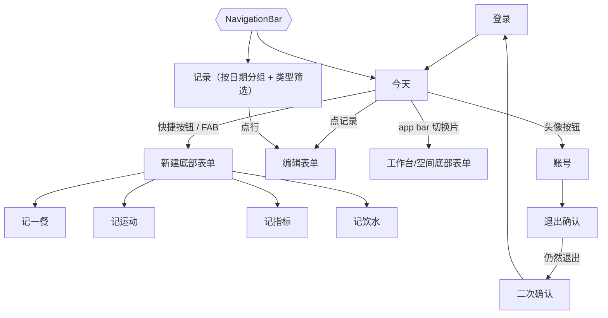

# 知衡原生 App v1 界面设计（Flutter / Material 3）

原型：`prototype.html`（单文件，390×844，点击左侧目录或界面切换）。截图：`screens/*.png`。令牌：`tokens.md`、`zhiheng_theme.dart`。
后端 API 不变：`/api/auth/login`、`/api/auth/me`、`/api/bootstrap`、`/api/state?space=&workbench=`、`/api/items`、`/api/items/:id`、`/api/workbenches`。

## 1. v1 记录类型选择
服务端 kind：meal、exercise、metric、water、dose/medication、visit、report、file、task。
v1 选 **记一餐 meal、记运动 exercise、记指标 metric（体重/血压/血糖/睡眠/静息心率）、记饮水 water**：
- 网页快捷入口（quick.js / daily.js / shell.js）只直接提供这几类，属于每日高频；
- 字段简单、纯文本/数值，无需附件，适合离线创建；
- dose/medication 有排期与重复校验（v1 不做），visit/report/file 依赖附件（v1 不做），task 属于备忘待办（v1 不做）。

## 2. 信息架构

NavigationBar 仅 2 项：「今天」「记录」。账号入口为今天页 app bar 右侧头像按钮（48dp）→ 账号页（返回箭头，无底栏）。
金融工作台：v1 只读，见「产品决定」。

## 3. 全局布局
- Edge-to-edge，状态栏透明，深色图标；底部手势区留 inset。
- 4/8dp 网格：页面左右 16，卡片内边距 16，卡片间距 12，区块 24。
- App bar 64dp：标题 22sp/600；右侧「工作台 · 空间 ▾」tonal chip（高 40，可点区域 48）。
- NavigationBar 80dp，选中态 = 实心图标 + 指示器胶囊 + 加粗标签（不只靠颜色）。
- FAB extended「＋ 记录」，距底栏 16。
- 系统返回：表单有改动→放弃确认；底部表单→关闭；今天页→退出应用。
- 转场：push 用 M3 shared-axis（X），表单用全屏 dialog 从下滑入（300ms emphasized），sheet 用标准 modal bottom sheet；全部可点元素有 ripple。

## 4. 各屏规格
### 登录（login*.png）
- Logo 64、标题 28sp、副标题「登录后自动保持 30 天」。
- 邮箱、密码 OutlinedTextField 56dp；密码可显隐（48dp 图标按钮）。
- 主按钮 48dp 全宽；登录中：禁用 + 18dp spinner +「登录中…」，按钮宽度固定不跳动。
- 状态行（固定 24dp 高，role=status）：3s 后「网络较慢，正在连接…」；15s 取消请求，显示「连接超时，请重试」（error 色），按钮恢复。
- 401：密码框 error 态，下方「邮箱或密码不正确」。
- 会话：App 登录后拿到专用令牌，存在系统安全存储里，请求时放在 Authorization: Bearer 头里，30 天有效，用着自动续期；启动时有令牌直接进今天（先用缓存），后台 `/api/auth/me`，401 才回登录。
### 今天（today*.png）
- 顺序：离线/失败横幅 → 日期概要卡 → 4 个快捷按钮（72dp）→ 今日记录卡（行 56dp+，图标 40 圆）。
- 空状态：概要显示「今天还没有记录」，插画卡「从第一条记录开始」。
- 骨架屏：仅首次登录且本地无缓存时出现，shimmer 1.4s；有缓存永远先显示缓存。
### 今天 · 金融（today-finance.png）
概要卡「金融工作台 · 只读」→「最近备忘」卡 → 「待办」卡（只读行）；隐藏 FAB 与快捷按钮；空白区居中 hint「金融记录暂时请在网页版添加」。
### 记录（records.png, records-filtered.png）
- App bar「记录」+ 工作台切换片；下方横向 FilterChip：全部 / 一餐 / 运动 / 指标 / 饮水（单选，选中 = ✓ + 底色 + 加粗，高 40、点击区 48）。
- 按日期分组（组标题 14sp/700 hint 色），组内卡片 + 56dp 行，右侧 ›；同一天内按时间倒序（最新在上）；点行进入编辑表单。保留 FAB。
- 分页：本地缓存按日期倒序懒加载。
### 新建底部表单（add-sheet.png）
四项 56dp 行；底部提示「用药、就诊、附件请在网页版记录」。
### 记录表单（form-*.png）
- 全屏 dialog：✕ 关闭、标题、右侧「保存」文本按钮。
- 一餐：餐次 segmented（早/午/晚/加餐，默认按时间）、日期时间、吃了什么、备注。
- 运动：类型下拉（默认上次/步行）、日期时间、时长（1–1440 分钟，supporting text 常显）。
- 指标：类型 segmented、日期、数值（血压为收缩/舒张两栏），supporting 显示上次值。
- 饮水：+200/+300/+500 快捷片、数值（≤5000 ml）。
- 校验在保存时并在失焦时：错误放字段下方，例「日期不能晚于今天」；服务端错误文案原样显示在对应字段或 SnackBar。
- 编辑：底部「删除记录」（error 色）→ SnackBar「记录已移除 撤销」。
- 有改动关闭/返回 →「放弃未保存的内容？」[继续编辑][放弃]。
### 工作台 / 空间（switcher.png）
单选列表（选中 = 勾 + 底色 + 加粗）；空间用 segmented「个人空间 / 示例空间」+ 说明「示例空间为演示数据，可随意修改」。切换后立即显示该组合的缓存，后台拉取。
### 账号 / 退出（account.png, logout.png, logout-confirm2.png）
显示账号、「本机缓存仅属于当前账号；切换或退出账号时清除」、待同步条数、网页版入口（备忘待办·用药·设置·邀请成员）。退出：无待同步 → 普通确认；有 N 条待同步 → 对话框「有 N 条记录还没同步，退出后会从这台手机上删除」，主按钮「先同步」，「仍然退出」为 error 色文本按钮 → 二次确认「确定删除未同步记录？」，「删除并退出」为 error 色实心按钮。离线也允许退出。

## 5. 同步与离线（UI 规则）
| 状态 | 表现 |
|---|---|
| 同步中 | 标题旁 16dp spinner（hint 色，带无障碍标签「同步中」），不阻塞操作 |
| 离线 | 顶部横幅「离线中，记录会在联网后同步」（warn 底），可继续记录 |
| 待同步 | 记录行右侧 badge「⏱ 待同步」（图标+文字） |
| 失败 | error 横幅「N 条记录同步失败 [重试]」；行内 badge 变「同步失败」 |
- 本地 SQLite 按 `userId/workbench/space` 分库或分表；退出登录、切账号删除整库。
- 写入先落本地，App 生成 UUID v4 作为 id，入队上传。服务端（dev 另开 PR）：`id` 可选；同账号同空间重复提交同 id → 返回已有记录（不重复、不报错，视为成功）；该 id 属于其他空间/账号 → 409，App 标记该条「同步失败」，并以新 UUID 重试一次后仍失败再提示；每次 409 重试都在本机写一条日志（时间、类型、旧 id、新 id、结果），供排查。
- 冲突：服务端为准，覆盖本地，Snackbar 点名记录：「『早餐』已在别处修改，已更新为最新内容」；服务端已删除 → 本地删除，「『早餐』已在别处删除」。多条合并为「N 条记录已在别处更新」。（sync-conflict.png）
- 饮水目标：读服务端设置（`/api/settings`）中的目标，无则默认 2000 ml；v1 不提供修改入口。
- 回前台、联网、下拉刷新时同步；保存成功 SnackBar「记录已保存」。

## 6. 无障碍
触控 ≥48dp；正文 ≥14sp，最小 12sp；文字对比 ≥4.5:1（ink/白 11.2:1，green/白 5.6:1，hint/bg 5.1:1，error/白 6.0:1；旧 muted #82918a 不用于文字）；选中态均含形状/图标变化；支持系统字体放大到 1.3× 不截断。

## 7. 开发需要
1. 后端：`/api/items` 支持可选 id 与上述幂等/409 语义（dev PR）。
2. 专用令牌：登录返回令牌，存系统安全存储，`Authorization: Bearer` 发送，30 天有效、使用中自动续期。
3. 本地库 schema 与同步队列；4 个表单字段与服务端校验对齐（server.mjs `put()`）。

## 产品决定（2026-11-01）
1. 金融工作台 App v1 只读：今天页显示最近备忘和待办，隐藏新建/FAB，空白处提示「金融记录暂时请在网页版添加」。
2. App 生成 UUID；服务端 id 可选；同账号同空间重复 id 返回已有记录；被其他空间/账号占用返回 409。后端改动由 dev 另开 PR。
3. 底栏仅「今天」「记录」；账号/退出入口移到今天页 app bar 头像。「记录」页按日期分组，筛选 全部/一餐/运动/指标/饮水，点行编辑。
4. 有未同步记录时退出：提示「有 N 条记录还没同步，退出后会从这台手机上删除」，主按钮「先同步」，退出为危险色且需二次确认；离线也可退出。
5. 同步冲突：服务端为准，Snackbar 点名记录；服务端已删除则本地删除并提示。
6. 饮水目标：有服务端设置用设置，否则 2000 ml；v1 无修改入口。
